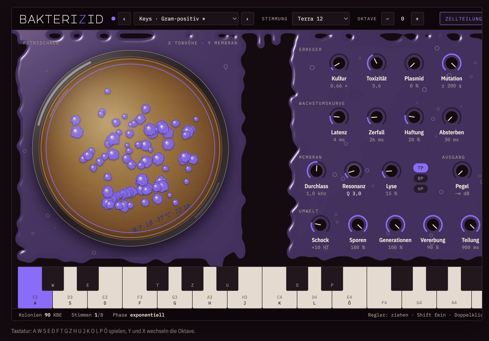

<h1 align="center">BAKTERIZID</h1>

<p align="center"><b>Xeno-FM-Synthesizer mit einer Petrischale als Spielfläche</b><br>
Kostenlos und quelloffen · VST3 · Audio Unit · Standalone · macOS, Windows, Linux</p>

<p align="center"></p>

<p align="center"><i>A free, open-source alien FM synth (VST3 / AU / Standalone) for macOS, Windows and Linux. UI in German.</i></p>

## Download

| System | Datei |
|---|---|
| **Mac** (Apple Silicon und Intel, ab macOS 11) | [Bakterizid-1.0.0-macOS.pkg](https://github.com/mopamin/bakterizid/releases/download/v1.0.0/Bakterizid-1.0.0-macOS.pkg) |
| **Windows** 10 / 11 (64 Bit) | [Bakterizid-1.0.0-Windows-Setup.exe](https://github.com/mopamin/bakterizid/releases/download/v1.0.0/Bakterizid-1.0.0-Windows-Setup.exe) |
| **Linux** | [Bakterizid-Linux.tar.gz](https://github.com/mopamin/bakterizid/releases/download/v1.0.0/Bakterizid-Linux.tar.gz) |

Alle Versionen findest du unter [Releases](https://github.com/mopamin/bakterizid/releases). Die Installer sind nicht signiert. Wie du die
Warnung beim ersten Öffnen bestätigst, steht in der [Installationsanleitung](INSTALLATION.md).

## Klang

| Feld | Regler | Was passiert |
|---|---|---|
| Erreger | Kultur, Toxizität, Plasmid, Mutation | FM-Verhältnis, FM-Index, Ringmodulation, zufällige Tonhöhendrift |
| Wachstumskurve | Latenz, Zerfall, Haftung, Absterben | Attack, Decay, Sustain, Release |
| Membran | Durchlass, Resonanz, Lyse, TP/BP/HP | Filter mit Hüllkurve, Sättigung, Filtertyp |
| Umwelt | Schock, Sporen, Generationen, Vererbung, Teilung | Tonhöhen-Hüllkurve (Kick-Punch), Rauschen, Echo, Echo-Rückkopplung, Arpeggiator-Takt |
| Ausgang | Pegel | Ausgangslautstärke mit Pegelanzeige |

Dazu:

- **23 Presets** in sechs Kategorien: Drums, Bass, Keys & Plucks, Leads, Pads, Kulturen & FX.
  Sie erscheinen auch in der Preset-Liste deiner DAW.
- **Petrischale als XY-Feld:** ziehen spielt einen gleitenden Ton, auf dem Agar wachsen Kolonien.
- **Stimmungen:** Terra 12 (normal), Xeno 19, Bohlen-Pierce, Obertonreihe.
- **Zellteilung:** Zufalls-Arpeggiator. **Bakterizid:** tötet alle Stimmen mit einem Rauschsturz ab.
- Alle Regler sind in der DAW automatisierbar.

## Aufbau des Projekts

```
Source/Engine.h           Klangerzeugung (Stimmen, Filter, Echo, Hall, Arpeggiator)
Source/Presets.h          Factory-Presets
Source/PluginProcessor.*  Parameter, Presets, Speichern und Laden
Source/PluginEditor.*     Fenster mit eingebetteter Web-Oberfläche und Brücke zur Klangerzeugung
UI/index.html             Die komplette Oberfläche (HTML, CSS, JavaScript)
UI/fonts/                 Schriften (SIL Open Font License)
docs/screenshot.png       Bildschirmfoto für diese Seite
installer/                Mac-Installer (.pkg), Windows-Installer (Inno Setup), Linux-Skript
.github/workflows/        Automatische Builds für alle drei Systeme
```

## Selbst bauen

Du brauchst **CMake 3.22+** und einen C++17-Compiler. JUCE lädt der Build selbst herunter.

**Mac** (Xcode-Kommandozeilentools: `xcode-select --install`, CMake: `brew install cmake`):

```bash
./build.sh          # baut und installiert die Plugins für dich
./build.sh --pkg    # zusätzlich den Installer in dist/
```

**Windows** (Visual Studio 2022 mit „Desktopentwicklung mit C++“): einmalig das WebView2-SDK holen,
dann bauen. In der PowerShell:

```powershell
Register-PackageSource -provider NuGet -name nugetRepository -location https://www.nuget.org/api/v2 -Force
Install-Package Microsoft.Web.WebView2 -Scope CurrentUser -RequiredVersion 1.0.3485.44 -Source nugetRepository -Force
cmake -B build -G "Visual Studio 17 2022" -A x64
cmake --build build --config Release
```

**Linux** (Ubuntu/Debian):

```bash
sudo apt install build-essential cmake ninja-build libasound2-dev libjack-jackd2-dev libfreetype6-dev \
  libfontconfig1-dev libx11-dev libxcomposite-dev libxcursor-dev libxext-dev libxinerama-dev \
  libxrandr-dev libxrender-dev libgtk-3-dev libwebkit2gtk-4.1-dev libcurl4-openssl-dev
cmake -B build -G Ninja -DCMAKE_BUILD_TYPE=Release
cmake --build build
```

## Auf GitHub veröffentlichen

1. Neues Repository auf GitHub anlegen und diesen Ordner hochladen (ohne `build/` und `JUCE/`, die
   `.gitignore` sorgt dafür).
2. Unter **Actions** baut GitHub automatisch für Mac, Windows und Linux.
3. Für ein Release einen Tag setzen, z. B.:
   ```bash
   git tag v1.0.0
   git push origin v1.0.0
   ```
   Dann erscheinen Installer und Archive unter **Releases**.

Die Installer sind **nicht signiert**. Mac und Windows zeigen deshalb beim ersten Öffnen eine Warnung.
Wie man sie bestätigt, steht in [INSTALLATION.md](INSTALLATION.md).

## Lizenz

Bakterizid steht unter der **GNU Affero General Public License v3** ([LICENSE](LICENSE)), weil es mit
[JUCE](https://juce.com) unter dessen AGPLv3-Lizenz gebaut ist. Du darfst es frei nutzen, verändern und
weitergeben. Veränderte Versionen müssen ebenfalls unter der AGPLv3 offen bleiben.

Schriften: Major Mono Display und IBM Plex stehen unter der SIL Open Font License 1.1
(`UI/fonts/OFL-*.txt`). VST ist eine Marke der Steinberg Media Technologies GmbH.
